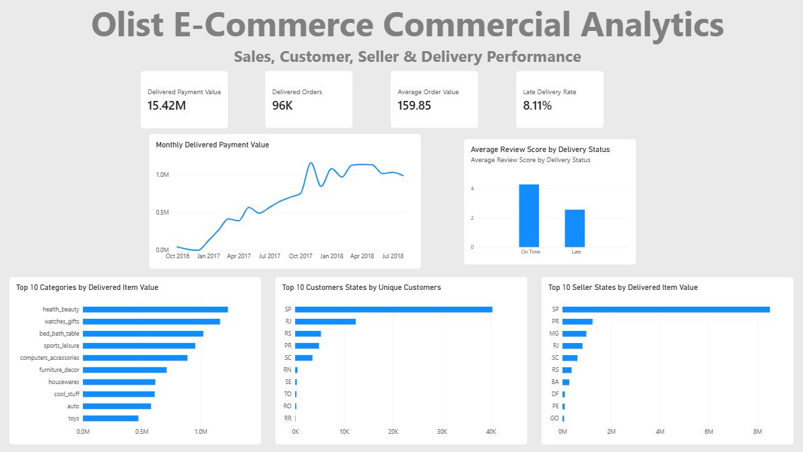

# Olist E-Commerce Commercial Analytics

I built this project to practise working through an e-commerce dataset from raw data inspection to commercial analysis and dashboard reporting.

The aim was not just to write SQL queries, but to understand how the different parts of an online marketplace connect: orders, customers, products, sellers, payments, delivery performance and customer reviews.

I used **Python, Pandas, DuckDB, SQL and Power BI** throughout the project.

## What I wanted to understand

I approached the dataset from a commercial point of view and focused on questions such as:

- How much value is being generated through delivered orders?
- How does sales performance change over time?
- Which product categories generate the most value?
- Which sellers and seller locations contribute the most?
- Where are customers concentrated geographically?
- How common are repeat customers?
- How often are orders delivered late?
- Is late delivery associated with poorer customer reviews?

## Dataset

The project uses the **Olist Brazilian E-Commerce Public Dataset**, which contains information from a Brazilian online marketplace.

The data is split across multiple tables covering:

- Orders
- Customers
- Order items
- Products
- Sellers
- Payments
- Reviews
- Product category translations
- Geolocation

The orders in the dataset range from **September 2016 to October 2018**, although the first and last years are only partial periods.

One of the main things I learned while working with the dataset was the importance of understanding the **grain** of each table before joining them.

For example, `orders` contains one row per order, while `order_items`, `payments` and `reviews` can contain multiple rows for the same order. I therefore aggregated these tables to the correct level before joining them where necessary to avoid double counting.

## Tools

### Python and Pandas

I used Python at the beginning of the project to inspect each dataset, understand its structure and check:

- Row and column counts
- Data types
- Missing values
- Duplicate records
- Unique identifiers
- Date ranges
- Category distributions
- Table relationships

This helped me understand the data model before moving into SQL.

### DuckDB and SQL

I loaded the datasets into a persistent DuckDB database and used SQL for most of the commercial analysis.

The SQL work includes:

- `JOIN` and `LEFT JOIN`
- CTEs
- Aggregations
- `COUNT(DISTINCT ...)`
- Conditional logic
- Date calculations
- `DATE_TRUNC`
- `DATE_DIFF`
- Window functions
- `LAG()`
- Month-over-month calculations
- Data reconciliation
- Analytical views for Power BI

The cleaned SQL analysis is available here:

[`sql/olist_analysis.sql`](sql/olist_analysis.sql)

### Power BI

After completing the SQL analysis, I created two analytical views at different levels of detail.

`order_summary` contains one row per order and is used for order, customer, payment, delivery and review analysis.

`sales_detail` contains one row per order item and is used for product, category and seller analysis.

I then used these datasets to build the Power BI dashboard shown above.

## Key Findings

### Overall commercial performance

Delivered orders generated approximately **15.42M** in recorded payment value.

There were **96,478 delivered orders**, with an average delivered order value of approximately **159.85**.

The monthly trend shows strong growth during 2017, with particularly high activity towards the end of the year and continued high payment values throughout much of 2018.

Because 2016 and late 2018 are incomplete periods in the dataset, I treated comparisons involving those periods carefully.

### Product categories

Product volume and product value did not always tell the same story.

**Health & Beauty** generated the highest total item value, while **Bed, Bath & Table** recorded a higher number of item sales.

**Watches & Gifts** also generated high commercial value despite having lower sales volume than some of the largest categories, reflecting its higher average item price.

This was a useful reminder that the highest-selling category is not automatically the most valuable category.

### Seller performance

Seller activity is heavily concentrated in **São Paulo (SP)**.

SP contains the largest number of sellers and generated by far the highest item value among seller states.

I also found that seller volume and seller value can differ significantly. Some sellers process large numbers of items, while others generate greater value from fewer, higher-priced products.

I also checked for orders involving multiple sellers and found **1,278 multi-seller orders**, representing roughly **1.3%** of orders containing item records.

### Customer behaviour

The dataset contains approximately **96,096 unique customers** based on `customer_unique_id`.

Repeat purchasing appears relatively limited within the available dataset period:

- Around **96.9%** of customers placed one order
- Around **3.1%** placed more than one order

This should not automatically be interpreted as long-term customer retention because the dataset only covers a limited observation period.

Customer activity is also geographically concentrated. **São Paulo** represents roughly **42%** of the state-level unique customer count, followed by Rio de Janeiro and Minas Gerais.

### Delivery performance

Average delivery time for completed orders was approximately **12.5 days**.

Around **8.11%** of analysed delivered orders arrived after their estimated delivery date.

This became particularly interesting when delivery performance was compared with customer reviews.

Orders delivered on time had an average review score of approximately:

**4.29 / 5**

Late orders had an average review score of approximately:

**2.57 / 5**

That is a difference of around **1.72 review points**.

This does not prove that late delivery directly causes lower reviews, but the dataset shows a strong association between delivery delays and poorer customer satisfaction.

### Customer reviews

Customer reviews were generally positive.

Approximately **77%** of review records received either four or five stars, while roughly **15%** received one or two stars.

The relationship between delivery status and review score was one of the clearest operational findings from the project.

## Data Validation

I also wanted to check whether the financial tables were broadly consistent with each other.

The raw payment table and order item table cannot safely be joined directly because both may contain multiple rows for the same order.

Instead, I first aggregated:

- Order items to one row per order
- Payments to one row per order

I then compared total item value plus freight against recorded payment value.

Across the matched orders, the average absolute difference was only around **0.03**, suggesting that the two sources reconcile very closely overall.

There were a small number of larger differences, which I documented rather than removing because they may represent genuine characteristics of the source data.

## Dashboard

The Power BI dashboard focuses on a small set of commercial and operational KPIs:

- Delivered Payment Value
- Delivered Orders
- Average Order Value
- Late Delivery Rate

It also shows:

- Monthly delivered payment performance
- Average review score by delivery status
- Top product categories by delivered item value
- Top customer states
- Top seller states

The aim was to keep the dashboard focused enough that someone could understand the main commercial story quickly rather than filling the page with unnecessary visuals.

## Repository Files

### `01_olist_data_setup.ipynb`

The Jupyter notebook contains the exploratory workflow used to inspect the datasets, understand their structure, load them into DuckDB and develop the analysis.

[`View the notebook`](01_olist_data_setup.ipynb)

### `sql/olist_analysis.sql`

A cleaned version of the main SQL analysis, including customer, seller, product, sales, delivery and review analysis along with the analytical views created for Power BI.

[`View the SQL analysis`](sql/olist_analysis.sql)

### `Olist_eCommerce.pbix`

The Power BI Desktop report used to build the final dashboard.

[`Power BI report`](Olist_eCommerce.pbix)

### `Olist_Ecommerce.png`

A preview of the finished Power BI dashboard.

## What I learned

This project helped me move beyond simply knowing SQL syntax and think more carefully about how data should be analysed in a real business setting.

The biggest lessons for me were:

- Always understand what one row represents before joining tables.
- Aggregating tables to the correct grain can prevent serious double-counting errors.
- Revenue, volume and customer behaviour can tell very different stories.
- Data discrepancies should be investigated before deciding whether they are actually errors.
- A technically correct analysis still needs to be translated into a clear commercial story.
- Dashboards are more useful when they focus on a few meaningful metrics rather than displaying everything available.

The project also gave me practical experience taking an analysis through the full workflow:

**raw CSV files → Python exploration → DuckDB → SQL analysis → Power BI → business insights**
